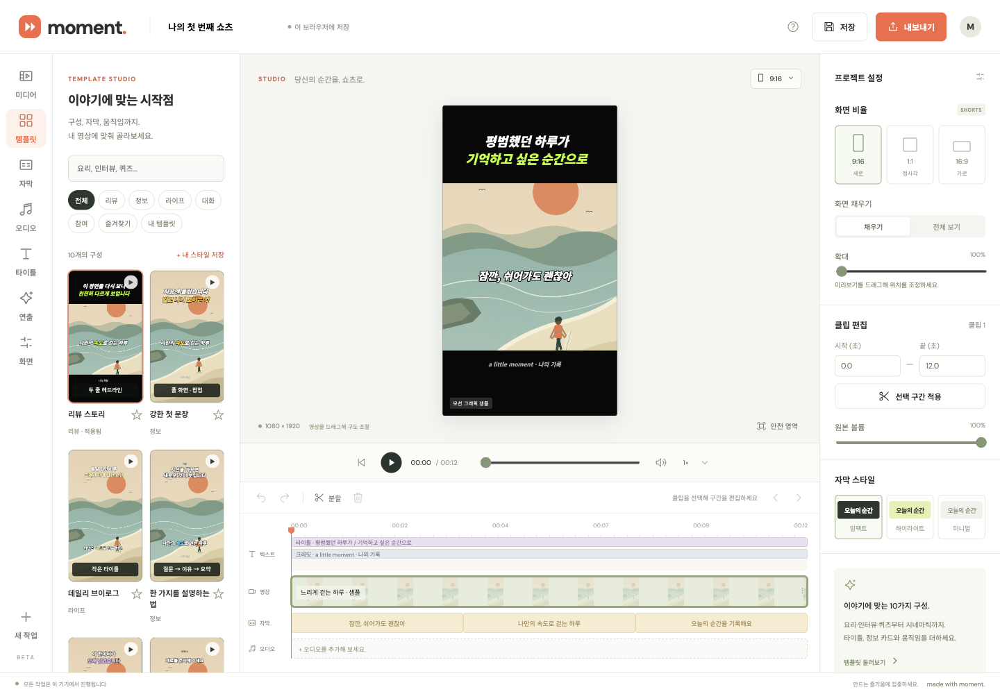
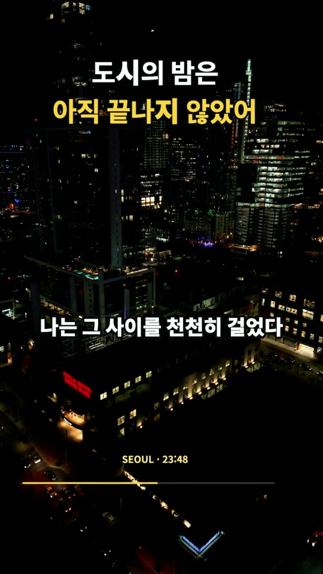

# Moment · Shorts Studio

**Turn your footage into short videos, with editing, captions, and export in your browser.**

**English** · [한국어](README.ko.md) · [简体中文](README.zh-CN.md)

[](https://github.com/bugtype/moment-shorts-cut/actions/workflows/ci.yml)
[](LICENSE)

Moment is a local-first video editor with Korean, English and Simplified Chinese interfaces. Trim a clip, choose a template, add captions or narration, and export a short without uploading your media to an app server. No account or API key is required.

The editor also exposes a shared command core, a project JSON CLI with SRT/VTT/TXT export, and a local stdio MCP server for AI clients. This is an early-stage project; see [tested behavior and remaining gaps](docs/BROWSER_QA.md) before relying on a particular browser or codec.



[Quick start](#quick-start) · [Features](#features) · [Examples](#example-results) · [CLI and integrations](#cli-and-integrations) · [Privacy and limits](#privacy-and-limits) · [Development](#development)

## Quick start

You need **Git and Node.js 20 or later**, including npm. There are no npm dependencies to install and no build step.

```sh
git clone https://github.com/bugtype/moment-shorts-cut.git
cd moment-shorts-cut
npm start
```

Open [http://127.0.0.1:4173](http://127.0.0.1:4173). The editor starts with a **12-second motion-graphic sample**, so you can try templates and export before bringing your own footage. The sample captions are examples; the sample has no speech to transcribe.

Keep the server running while editing; press `Ctrl+C` to stop it. It binds to `127.0.0.1` and serves only `dist/`. Open the HTTP address rather than double-clicking `dist/index.html`, because the app uses JavaScript modules, workers, and browser storage.

### Interface language

Choose **한국어**, **English** or **简体中文** in the language selector. A saved
choice takes priority over a supported browser language; otherwise the editor uses
Korean. If browser storage is unavailable, switching still works for the current
session, but the choice may not survive a reload.

Changing the interface language does **not** translate your project name, captions,
titles, credits, speaker names, imported files or saved custom-template content.
Existing Korean demo and built-in example text stays Korean; applying example
content remains an explicit edit. Language selection does not change the speech
recognition language. Choose that separately for the source audio.
Screenshots and rendered examples below show their original Korean content.

### Make your first short

Select **English** in the language selector. The steps below use English interface labels:

1. **Media:** upload a video, or keep the sample. Use **Frame** to choose 9:16, 1:1, or 16:9 and adjust the framing; trim, split, and reorder clips on the timeline.
2. **Templates:** choose a composition. **Apply style only** keeps your text; applying the example composition replaces title, credit, and timed-text content while preserving footage and dialogue captions.
3. **Captions:** import SRT/VTT, write captions, or generate them locally from speech. Review the text and timing. Use **Title** and **Effects** for headlines and timed text.
4. **Audio:** add an audio file or record narration with microphone permission. Adjust its start time and volume alongside the original audio.
5. **Export:** choose an available MP4/WebM format and 720p or 1080p. **Keep the tab visible until export finishes**, then play the downloaded file to check the result.

The header folder icon opens **Project files**, including on compact screens. **Help** also provides the file actions.

| Action | Where your work goes |
|---|---|
| **Save** | Browser storage |
| **Project files → Save settings** | Download a `.moment.json` metadata backup |
| **Project files → Import settings** | Restore a saved settings document |

Settings files must fit **10 MiB (10,485,760 UTF-8 bytes)** for both save and restore; oversized output is rejected, not truncated. Keep your original video and audio separately: **the JSON does not contain media files**.

| Next task | Read only what you need |
|---|---|
| Navigate the preview | [Fine steps, cut boundaries and exact output time](#navigate-the-preview) |
| Edit timing | [Capture trim values and set an exact speed](#edit-timing-from-the-preview) |
| Save an image | [Click-time preview PNG and bitmap dimensions](#save-a-preview-image) |
| Repeat playback | [Session-only loop, card preview and export boundaries](#repeat-the-full-preview) |

## Features

| Work on | Available tools | Important boundary |
| --- | --- | --- |
| Video and timing | Trim, split, reorder, delete, speed, pan/zoom, undo/redo; brightness, contrast, saturation, vignette, slow zoom and progress bar | One source video and one video track; boundary fades/flash do not overlap clips |
| Layout and text | 10 built-in templates, search/favorites, up to 20 local custom templates with individual JSON import/export, title/credit styling and 12 timed text layers | Style-only preserves authored text; example content replaces title, credit and timed cards |
| Captions and audio | SRT/VTT import, edited SRT/VTT/TXT export, literal find/replace-all, highlighting, effects, two manual speakers; one added audio file or microphone narration | On-device ASR uses Transformers.js 3.8.1 + `Xenova/whisper-tiny`; recognition and estimated split timing need review |
| Save and automate | Browser storage, project JSON, CLI, repository skill and stdio MCP; Canvas/Web Audio → MediaRecorder export | Project JSON contains no media; CLI/MCP do not encode video |

The built-in templates cover review stories, bold opening lines, vlogs, explainers, interviews, recipes, rankings, product reviews, quizzes, and cinematic moments. Preview each with its animated sample. Quiz choices and countdowns are video graphics, not interactive polls.

**Compare a template on your scene:** open a template preview and choose **Current
scene**, then switch **Current style / Selected style**. Both use the same frozen
raw frame and current timeline time; the selected view applies the existing
style-only rules to a detached project copy. Authored title/credit/card text and
captions are retained, but visual settings and applicable layer timing can differ.
Comparison does not apply the template, edit, save, seek or play audio; opening the
template preview already pauses playback. Use the existing apply buttons only when ready.
The dialog starts in **Sample**, which remains available when current media is not ready. Reopen after the
project, media, selection or playhead changes. This is a visual preview, not a
native-resolution or source-frame-accurate export.

**Reuse a card’s appearance:** choose **Copy style** on the selected timed card, select
another card, then **Paste style**. Only color, text size/stroke, background styling, presentation
and animation transfer; text, timing, position/width, role, type and enabled state stay intact.
The copied snapshot lives only in editor memory, not the OS clipboard or storage;
later source edits/deletion do not change it. A changed paste is one undo step;
pasting an identical style changes nothing.

### Share a custom template

Export an individual custom-template card in the gallery, then use the gallery’s
import button in another browser. Import adds a **new copy** under **My templates**,
with a new ID; it does not replace a saved template, change favorites or apply
the template to the current project. Preview it, then choose style-only or
example-content application as usual.

**Rename a saved template** from its custom card without making another copy.
Names are trimmed, nonblank and at most 40 UTF-16 code units. The ID, favorites,
saved styling/content and current project stay intact, even with a full 20-entry
library. Names need not be unique; gallery search and export filenames use the
new name. Cancel or a failed save keeps the original. A failed save leaves the
dialog open for retry.

**Update a saved custom template from the current composition** using its card’s **Update from current composition** action, then confirm **Update**. The composition is captured when you confirm, replacing
saved styling/content while keeping the template’s ID, name, category and favorites.
This works even with 20 templates: it replaces one, not appends a copy. It does not
change the current project, media or other projects, or automatically apply a template.
Export the old template first if you need a backup; this is an overwrite, not version history.
Cancel or a failed save preserves the original; a failed save allows retry.

| File | What it carries | What it does not do |
|---|---|---|
| Project JSON | Editing settings, timeline and captions | Embed source media |
| Single-template JSON | Saved styles, title/credit/card text, keywords and speaker labels | Back up the whole library or current project |
| SRT/VTT | Edited subtitle text and timing | Preserve visual styling or media |
| TXT | Edited caption text in output order | Recover timing or act as a project backup |

**Review saved wording before sharing a template.** There is no video/audio in the
file, but titles, credits, cards, global keywords and speaker labels can be private.
Import accepts UTF-8 JSON up to 256 KiB, including an optional leading BOM, and
requires room in the 20-template library. Invalid files or failed saves leave the
library and current project unchanged. [File contract and recovery](INTEGRATIONS.md#개별-사용자-템플릿-파일)
cover format/version checks and concurrent selections. This browser-library
workflow remains separate from CLI/MCP: they can [apply an exported template document](INTEGRATIONS.md#내보낸-템플릿을-climcp로-적용) to the current project, but cannot list or save the browser’s custom-template library.

CLI/MCP can also [export the current composition as a portable template](docs/MCP.md#export-the-current-composition-as-a-template) with `template.export`, without changing the project or browser library. This captures style and saved title/credit/card content, not captions or media.

## Preview and timing reference

### Navigate the preview

**Preview shortcuts:** unmodified `,` / `.` move backward/forward by 1/30 of an
output second to inspect cut or caption boundaries. Arrow keys still move one
pre-speed timeline second. The fine step uses the 30 fps output reference—not
source-frame accuracy or frame-grid snapping—and retains any starting subframe
offset. It is ignored in editing fields, during IME composition, with modifier
keys or while busy.

**Review cut boundaries:** use **Previous cut / Next cut** beside the scrubber to
pause and move to the strictly previous/next edited clip boundary, including the
start and end. At a boundary, the next action goes to the adjacent boundary, not
back to the same one. Unmodified `[` / `]` do the same; they are ignored in
editing/form controls, during IME composition, with a dialog open or while blocked
by busy state or recovery without session media access. At an endpoint with no boundary in that direction, nothing
changes, including playback. Speed changes displayed output times, not which cuts are
visited. Navigation does not select another clip, edit, save or add undo history;
this does not promise source-frame-accurate seeking.

**Go to an output time:** click the preview time display (**Go to output time**),
enter seconds such as `2.5`, `01:02.5` or `00:01:02.5`, then choose **Go**.
The value uses output time **after speed**, from zero through the output end.
Confirming pauses and seeks; cancel leaves playback unchanged. It does not edit,
save or add undo history. Reopen if the project or media source changed; busy/recovery guards apply.
This is time navigation, not frame/sample-accurate seeking.

### Edit timing from the preview

**Fill trim values from the playhead:** select a clip and move playback inside that
selected occurrence. Use the target icon beside start/end (**Use playhead for
start / Use playhead for end**). It pauses and fills only that field with the
source time, keeping its precision and the opposite draft unchanged. It does not
seek, edit, save or add history until you explicitly **Apply selected range**
(or **Apply range** in the **Frame** panel). Repeated source clips use the selected occurrence;
speed does not change the captured source value. Endpoint captures may leave an
invalid range: correct it before applying; the 0.1-second minimum still applies.
Outside the selected occurrence, the draft is left unchanged and a message asks
you to move inside it. This is not a source-frame-accuracy guarantee.

**Set an exact speed:** keep using the preview speed presets, or choose **Custom…**,
enter a finite multiplier from **0.25 to 4**, then **Apply**. The current value is
prefilled without rounding; non-preset values remain visible in the speed control.
This changes the whole project's preview/output speed, not one clip. Existing
speed-edit rules retime titles, credits and timed cards; stored clip/caption times
and audio-offset data keep their existing clocks. Canceling or applying the same
value does not edit, save, pause or add history. Reopen the dialog if the project
or media changed. Pitch, codec behavior and frame accuracy are not guaranteed.

### Repeat the full preview

In the **Frame** panel, enable **Loop full preview**, then start playback. This session-only
choice defaults off and resets on reload; it never changes project JSON, saves or undo history.

| Playback | Loop behavior |
|---|---|
| Full preview | Restarts from the beginning; enabling it while paused does not start playback |
| Timed-card preview | Still stops at that card’s end |
| Export | Always one pass, regardless of the preview setting |

Turning it off lets the current pass finish, but cancels a pending restart. Manual
pause/seek, hiding the tab or changing media takes priority. Seamless playback is not guaranteed.

### Save a preview image

In **Frame**, choose **Save preview PNG** to download the edited canvas **as displayed
when clicked**: 540×960 portrait, 960×960 square or 960×540 landscape. It captures
rendered video, text and effects—not DOM guides/selection handles or audio—and does
not rerender at 1080p, seek, pause or change project/history. No media is uploaded.
This works independently of MediaRecorder; it is not source-frame-accurate export.
Busy states and recovery without session media access block capture; a newer request or project/media change cancels
an outdated pending download. Normal playback advancing does not change the snapshot.

## Example results

Four 1080×1920 vertical shorts made with Moment's Canvas composition engine and built-in templates. Select a thumbnail to open the MP4.

<table>
<tr>
<td width="50%" align="center">
<a href="docs/examples/cinema-sunset.mp4"></a><br>
<strong>In front of the sunset</strong><br>
<sub>Cinematic moment · 11.5s</sub>
</td>
<td width="50%" align="center">
<a href="docs/examples/city-night.mp4"></a><br>
<strong>City night</strong><br>
<sub>Bold opening line · 10.3s</sub>
</td>
</tr>
<tr>
<td width="50%" align="center">
<a href="docs/examples/coffee-recipe.mp4"></a><br>
<strong>One cup for today</strong><br>
<sub>Recipe at a glance · 11.5s</sub>
</td>
<td width="50%" align="center">
<a href="docs/examples/forest-top3.mp4"></a><br>
<strong>Three things a rushed day needs</strong><br>
<sub>TOP 3 list · 10.9s</sub>
</td>
</tr>
</table>

The app's **Export** button records the same composition in real time with MediaRecorder. These examples were rendered frame by frame through the same renderer and encoded at 30fps H.264 for higher final quality. Sources, music credits, and production notes are in [docs/examples/README.md](docs/examples/README.md).

## CLI and integrations

The CLI edits **project settings and subtitles**. Run these commands from the repository root:

```sh
# Create a sample project.
node cli/moment.mjs init --out project.json

# Apply the included explainer composition.
node cli/moment.mjs exec template.apply --project project.json --args-file examples/explainer.json --out edited.json

# Export captions with edits and playback speed reflected in the timestamps.
node cli/moment.mjs exec captions.export --project edited.json --out captions.srt
node cli/moment.mjs exec captions.export --project edited.json --json '{"format":"vtt"}' --out captions.vtt
node cli/moment.mjs exec captions.export --project edited.json --json '{"format":"txt"}' --out captions.txt

# Replace matching caption text without changing timing or speaker metadata.
node cli/moment.mjs exec captions.text.replace --project edited.json --json '{"find":"하루","replacement":"하루의 기록"}' --out corrected.json

# Make all captions larger without replacing their text or timing.
node cli/moment.mjs exec captions.style.update --project corrected.json --json '{"patch":{"captionSize":48}}' --out styled.json

# List commands and their input schemas.
node cli/moment.mjs commands
```

Existing output files are protected; use `--overwrite` only when you intend to replace one. Add `--dry-run` to an `exec` command to inspect its result without writing output. JSON inputs are limited to 10 MiB (10,485,760 bytes).

### Pick a workflow

**Captions**

| Task | Use | Keep in mind |
|---|---|---|
| Read nearby authored captions | [`captions.list`](INTEGRATIONS.md#저장된-자막을-나눠-조회) | Read up to 50 exact cues per page, then target a current index with `captions.update`. Pre-speed times; live pages are not snapshots or project backups. |
| Insert or remove one caption | [`captions.insert` / `captions.remove`](INTEGRATIONS.md#자막-하나를-추가하거나-삭제) | Use the current authored index; no sorting or retiming of other cues. Re-read after uncertain results—blind retries can affect the wrong cue. |
| Edit one authored caption | [`captions.update`](INTEGRATIONS.md#자막-하나만-수정) | Patch text, timing, speaker or keywords without resending all cues. Read the current array index first; basis and estimated-timing metadata are preserved. |
| Correct repeated wording | [`captions.text.replace`](INTEGRATIONS.md#자막-문구-일괄-교정) | Literal, case-sensitive, non-overlapping; no regex/Unicode normalization. Preserves timing, speaker/keyword metadata and order. Blank or overlong results reject the whole edit. Browser UI previews occurrence counts and applies one undo step. |
| Locate a caption in the edit | Row action **View in video** | One occurrence seeks directly; repeated occurrences let you choose. Temporal navigation only, not an edit. |
| Review matches first | Browser previous/next search controls | Wrap through authored rows, including trimmed-out captions; scroll/focus/select each row’s first match and show current/total rows. One row counts once; replace-all counts occurrences. No playback seek, project edit or save. |
| Shift a constant subtitle delay | [`captions.timing.shift`](INTEGRATIONS.md#자막-시간을-앞뒤로-이동) | Choose source/timeline and signed seconds **before speed**. All cues in that basis move; any out-of-bounds result rejects the whole edit. Browser caption tools apply a real change as one undo step. |
| Review overlapping times | **Caption timing overlaps** or [`captions.overlaps`](INTEGRATIONS.md#자막-시간-겹침-점검) | One representative conflict per overlapping output occurrence, not all pairs or a visibility prediction. Read total/flagged/omitted counts. |
| Review dense caption timing | Browser **Check reading speed** or [`captions.inspect`](INTEGRATIONS.md#편집-후-자막-표시-속도-점검) | Read-only ranking against your chosen non-whitespace-graphemes/second threshold after cuts, repeats and speed. Not a language standard, speech-alignment or export-validity check. |
| Split one caption at the caret | [`captions.split`](INTEGRATIONS.md#자막-하나를-커서-위치에서-분할) or the row split action | Keeps literal text and metadata; estimates timing by grapheme counts, not speech alignment. A caret boundary must not cut an emoji/combined character. Separate from bulk long-caption splitting. |
| Merge adjacent captions | [`captions.merge`](INTEGRATIONS.md#인접한-자막-합치기) or row action **Merge with next caption** | Combines the next authored row, even across pages. Requires matching clock/speaker/keywords and non-overlapping chronological times; merged text also appears across any gap. One browser undo step. |
| Change appearance | [`captions.style.update`](INTEGRATIONS.md#자막-스타일-수정) | Size, position, colors and animation: only supplied fields change, without resubmitting the project. Visual styles are absent from plain SRT/VTT. |
| Import subtitle text | [`captions.import`](INTEGRATIONS.md#srtvtt-본문을-명령으로-가져오기) | Replaces all captions. Supply contents, not a path, and source/timeline time **before speed**, not output time. API: 100,000 UTF-16 code units; browser files: 2 MiB. |

**View in video** on a caption row pauses and seeks its temporal occurrence without
editing, saving, adding history or autoplaying. Repeated source clips open a chooser
with 20 occurrences per page (up to 1,000 clips); displayed times are after speed.
A trimmed-out cue only shows a notice. Reopen after project/media changes. This
navigates timing, not guaranteed rendered visibility: disabled captions or overlap
priority may hide the text, and source-frame accuracy is not promised.

**Caption timing overlaps** shows up to 20 issues in occurrence order. Related
caption buttons focus the authored row without seeking; **View range** pauses and
seeks the overlap, then focuses the first related row without autoplay. Touching
endpoints do not count. Reopen after project/media changes. Review changes nothing;
video navigation needs normal or confirmed session-media access. No automatic fix.

In **Check reading speed**, enter your own positive threshold; none is preselected.
The report shows up to 20 highest-rate occurrences plus total, flagged and omitted
counts. **Captions** focuses the authored row without seeking; **View range** pauses and
seeks that specific output occurrence, then focuses its row. Re-run if the project or threshold
changed since inspection. Inspection/navigation does not edit, save or add undo history.

The caption editor shows **50 rows per page**, with previous/next controls and a
visible range. With more than 50 cues, enter a **1-based page number** and press
**Go** or Enter to focus its first cue. Use 1 through the displayed last page
(up to 200 pages); invalid input stays focused for correction. Switching UI language
preserves the page-input draft and focus. Paging alone does not edit, save, create
undo history or seek playback. Search, timeline
selection, import and adding a caption reveal the target row’s page. Search,
replace-all and long-caption splitting still cover the full authored list; exports
retain the whole project’s clip/speed rules, not just the visible page. Existing
10,000-cue and 2 MiB limits are unchanged.

**Clips and composition**

| Task | Use | Keep in mind |
|---|---|---|
| Move a clip directly | **Move clip…** in the clip inspector or **Frame**, or [`timeline.move`](INTEGRATIONS.md#클립을-지정한-위치로-이동) | UI positions are 1-based; API indices are 0-based final destinations. Same position/cancel are no-ops. |
| Apply related edits together | [`project.batch`](INTEGRATIONS.md#여러-편집을-한-번에-반영) | Validate 1–20 supported edits in sequence, then commit once; a rejected step leaves the project unchanged. Not a JSON-RPC batch or a cross-host storage transaction. |
| Repeat a clip | [`timeline.duplicate`](INTEGRATIONS.md#클립-구간-복제) | Inserts the same source interval immediately after the selected occurrence, not a media-file copy. Source captions repeat; timed output layers rescale. |
| Split one clip | [`timeline.split`](INTEGRATIONS.md#클립-구간-분할) | Original source time, not output time; identify the intended occurrence and check boundaries. No full-timeline replacement. |
| Adjust video effects | [`effects.update`](INTEGRATIONS.md#영상-효과-수정) | Brightness, contrast, motion, boundary overlays and progress styling without replacing content or timing. Boundary overlays are not crossfades. |
| Set a source credit | [`credit.update`](INTEGRATIONS.md#출처-크레딧-수정) | Text, appearance and output-time visibility without changing title/captions/cards. Maximum 100 UTF-16 code units; not included in subtitle files. |
| Move a card without resizing | Selected card → **Move in time…** | Enter a new start in output seconds **after speed**; both endpoints update together as one undoable edit. |
| Script timed cards | [`overlays.add`, `overlays.update`, `overlays.remove`](INTEGRATIONS.md#스크립트에-맞춰-카드-추가삭제) | Individual IDs and output time **after speed**, without replacing the project. Additions append; `overlays.move` changes card stacking. UI offers **Bring to front / Send to back** (front/back) within the card stack. |

For example, to move a card from 0–3 to 7–10 seconds, choose **Move in time…**,
enter `7`, review the calculated end and choose **Move**. Its duration, ID, stacking
order, content and style remain; other cards are unchanged. A changed move pauses
playback but keeps the current playhead time—it does not seek to the card. The whole interval must
fit within the output: an out-of-range or too-long card is rejected, not cropped.
Cancel or the same start does not edit, pause, seek, save or add history. Card, title and credit start/end inputs show the stored decimal value without
two-decimal rounding and accept fractional seconds without a 0.1-second step grid.
An unset title/credit end stays blank/null; read-only summaries may still be rounded.
This does not change when edits commit or the existing interval checks. Fractional
times use ordinary floating-point precision, not sample accuracy. Reopen after
project, media or selected-card changes. Valid failed-recovery settings remain
in-memory edits only: browser saving stays blocked, so back up settings separately.

Choose **Move clip…**, enter a position from 1 to the clip count and choose **Move**.
A changed move is one undoable edit: selection follows the moved clip, playback
pauses and seeks its new start. Existing arrows use the same operation. The moved
clip’s trim drafts are preserved; do not assume all other panel drafts survive an
edit. Reopen if project/media/selection changed. Source ranges and stored caption
and title/card times are not rewritten; source-caption occurrences follow the new
order, while timeline captions retain their absolute times.
If recovery failed but valid settings were readable, moves remain in-memory edits;
browser saving stays blocked, so download a settings backup before reloading.


### Choose an integration

| Need | Use | Start here |
| --- | --- | --- |
| Edit project JSON or export caption files | Node CLI; existing outputs are protected | [Command contracts and file workflow](INTEGRATIONS.md) |
| Give an AI agent project guidance | Repository skill, no global installation | [Moment editor skill](.agents/skills/moment-editor/SKILL.md) |
| Connect an AI client | Local stdio MCP server: `node cli/mcp.mjs` | [Client setup, tools, errors and recovery](docs/MCP.md) |
| Integrate with your own code | Same-page `window.moment` or the reusable service/adapter | `node examples/use-editor-service.mjs` |

Run `node examples/use-mcp-client.mjs` for an executable handshake → import → edit → SRT → restart/reimport example. It launches local Node processes and keeps its exported document in memory; it does not write your files or connect to a browser.

**MCP changes disappear when its process exits.** Retrieve `moment_project_get` and save `structuredContent.data` through your client's authorized file workflow. The bundled server has one temporary `session` project, not your open browser project.

**`render.plan` does not produce an MP4.** Neither the CLI nor the bundled MCP server uploads media or encodes video. A custom remote host must supply its own transport, authentication and storage. An external AI client may send project text to its provider; review that client's privacy settings before sharing private captions.

## Privacy and limits

**Media stays on your device, but the app is not fully offline.** Fonts load from Google Fonts; automatic captions download code from jsDelivr and model/runtime assets from Hugging Face and related runtime sources. Speech inference runs in a browser worker. See [SECURITY.md](SECURITY.md) for network requests and trust boundaries.

| Input or project limit | Maximum |
| --- | --- |
| Video / additional audio | 500 MiB / 100 MiB |
| Project-settings JSON save/restore / SRT or VTT input | 10 MiB / 2 MiB, UTF-8 |
| Clips / source caption cues | 1,000 / 10,000; 2,000 UTF-16 code units per cue |
| Custom templates / timed text layers | 20 / 12 |

At 1,000 clips, delete a clip before splitting another.

**These are validation limits, not memory or codec guarantees.** Browser storage is not a backup: media and settings are written separately and can fall out of sync after a failed save. Keep the original media and export project JSON regularly.

**Automatic captions:** the original video must be **180 seconds or shorter**, even after trimming. Selected audio is processed for at most 180 seconds. Recognition, manual speaker labels and estimated split timing need review.

**Video export:** keep the tab visible; hiding it cancels recording. MP4/WebM support depends on the browser. Recording is real-time, with a 30 fps target rather than a fixed-rate guarantee. The historical 4-second Chromium test averaged about 21.7 fps; see [the measured report](docs/BROWSER_QA.md).

In the export dialog, **Include captions in video** starts checked each time.
Uncheck it to omit only Moment’s authored caption layer from this video export;
leave it checked to keep the project's existing caption visibility setting.
The choice is captured when you start and does not edit/save the project or add history.

| Output | Effect of unchecking |
|---|---|
| Recorded video | Omits authored captions; titles, credits, timed cards and source footage remain |
| Normal editor/PNG/template preview before and after export | Unchanged; PNG capture remains blocked while recording |
| Preview during recording | Mirrors the chosen recorded output, including omitted captions |
| SRT/VTT sidecar files | Unchanged; save separately from the caption panel |

This does not remove text already present in source pixels or create a switchable
subtitle track inside MP4/WebM. CLI/MCP `render.plan` has no new toggle and remains a plan, not video encoding.

<details>
<summary>Storage, pending imports and transcription conflicts</summary>

**Storage:** media is stored in IndexedDB and editing state in localStorage. They are written separately; a failed save can leave them out of sync. Storage belongs to the current browser and origin; changing the host or port opens a different storage area. Clearing browser data, private browsing, or storage exhaustion can lose work. There is no cloud sync or remote backup.

**Pending imports:** if the project changes while a text file is being read or waiting to apply, the import is rejected; select the file again to apply it to the current project. Selecting another JSON/SRT/VTT file supersedes the earlier pending import, even if the newer file fails. These checks cover applied project state, not uncommitted text-field drafts.

**Pending transcription:** results are not applied if the source media or existing captions changed, or the project was replaced; added-audio results also require unchanged audio offset and edited duration. Generate again against the updated input. Appearance changes remain usable. This protects applied edits, not uncommitted text-field drafts, and does not promise to stop model computation when a conflict is detected.

</details>

<details>
<summary>UTF-8, subtitle formats and timing rules</summary>

**Text imports:** save project JSON and SRT/VTT files as UTF-8; a leading UTF-8 BOM is supported. Subtitle LF, CRLF and CR line endings are normalized to LF while preserving payload line breaks. Invalid UTF-8 is rejected without replacing the current project or captions. Other encodings are not detected or converted automatically.

**Caption files:** select **SRT**, **VTT** or **TXT** and use the caption panel’s single save button. SRT is the default; the selection survives paging.

**Plain WebVTT:** select **VTT**, or pass `format: "vtt"` to the CLI/MCP export command. Omitting `format` still exports SRT; a `.vtt` filename alone does not select it. VTT uses a `WEBVTT` header and dot-separated milliseconds, with the same edited timing and text escaping. Rich styles, regions and speaker metadata are not exported. VTT rejects NUL characters. With no cues, CLI/MCP return `WEBVTT\n\n`; the browser does not download an empty caption file.

**Plain TXT:** one paragraph per derived cue, ordered using clips, repetitions and source/timeline captions after speed. Repeated or split clips can repeat words; this is not a deduplicated or word-accurate transcript. No timestamps, IDs, speakers, titles, cards or styling are included. Literal `<>&`, whitespace and multiline text are preserved, with LF line endings, a blank line between cues and a final newline. Blank lines and sub-millisecond cues are allowed; NUL is rejected. Empty export returns `""`. TXT cannot be imported by SRT/VTT import or recover cue timing.

**SRT/VTT text:** blank lines separate cues. Export rejects empty cues or blank lines inside an exported caption instead of dropping paragraphs or assigning new times. Remove the blank lines to export SRT/VTT; project JSON retains the original text. Ordinary multiline captions are supported, with CRLF/CR normalized to LF in output. Subtitle-player markup support varies; universal compatibility is not claimed.

**SRT/VTT timing:** timestamps round to milliseconds after trimming and speed changes. Export rejects a cue whose rounded start and end are equal; adjust its interval or playback speed. It does not extend, drop or move cues automatically, and the original project keeps its precise timing.

</details>

<details>
<summary>Derived caption budgets and long-caption splitting</summary>

**Derived caption limits:** the timeline caption lane and SRT/VTT/TXT export support at most 10,000 edited occurrences and 2 MiB of UTF-8 caption text, counting each clip repetition. Each completed caption file has a separate 2 MiB limit including escaping, timing, separators, the VTT header when present and any emitted BOM (browser SRT exports include a BOM; browser VTT/TXT and CLI/service exports do not). Exceeding a limit rejects the entire derived output, including for older projects; reduce repeated clips or captions to restore it. Original caption editing, project JSON, undo and saving remain available. These budgets do not guarantee UI responsiveness or available memory.

**Long-caption splitting:** the 12/18/24-character targets and estimated timing weights count grapheme clusters, keeping combining marks and joined emoji together without Unicode normalization. Whitespace at split boundaries is removed as whole clusters. This action requires native `Intl.Segmenter`; unsupported runtimes show an error and leave captions unchanged. The separate 2,000 UTF-16 code-unit input limit and UTF-8 byte budgets still apply. Segmentation depends on the runtime’s Unicode data, and estimated timing still needs review against the audio.

</details>

### Troubleshooting

- **The page does not load:** confirm `npm start` is still running. If port 4173 is occupied, stop the other server or set the `PORT` environment variable to an available port; use the address printed by the server.
- **A video will not open, or export is unavailable:** try an H.264 MP4 or WebM input and another browser with the required media APIs. MOV support depends on the codec inside the file. For export errors, also try 720p.
- **Automatic captions fail:** use a short original with audible speech, check the selected language and network access, or import SRT/VTT and edit manually. The built-in sample cannot be transcribed.
- **A project appears empty:** return to the same browser, host, and port. To restore JSON in another browser, first reconnect the original video and any additional audio, then choose **Project files → Import settings**.
- **Saved templates cannot be read:** malformed custom templates or favorites are isolated for the session, and library save/delete/favorite changes are blocked to preserve the original storage values. Built-in templates and project editing remain available when the project itself loads. Reload retries reading; it does not repair the library. No entries are automatically deleted or salvaged.
- **Restore fails:** the editor pauses project saving, media replacement, recording, and reset to preserve stored data. If settings were readable, you can edit them in memory and use **Project files → Save settings** before reloading. These edits are not saved in the browser. Reload only retries loading; it cannot recover missing media or guarantee codec support. An exit warning may appear for unsaved edits, but browsers may omit it. [Relink originals for this tab](#relink-originals-for-this-tab-only) can enable preview/export without repairing storage.

### Relink originals for this tab only

If restoration failed **but valid project settings were readable**, open **Project
files → Relink original files**. Select every required original
video/added-audio file, explicitly confirm they are this project's originals, then
choose **Connect for this tab**. Temporary probes and the actual editor media
elements must finish loading before playback access is enabled.

| After successful relinking | Boundary |
|---|---|
| Preview, seeking, video export and preview PNG | Available in this tab; no automatic playback |
| In-memory metadata edits, undo and settings backup | Still available; download the settings before reloading |
| Browser Save/autosave, ordinary import, reset, recording and ASR | Still blocked; storage failure/status is not cleared |
| Reload | Original files must be supplied again; this is not persistence repair |

Names must match, but matching names/durations **do not prove file identity**.
Video must cover the stored duration and all clips; it cannot be shorter and may
exceed the stored duration by at most 0.05 seconds. Added audio must have a finite
positive duration; no stored audio duration exists for comparison. The existing
500 MiB video / 100 MiB audio limits apply. Retain the actual originals.
Relinking itself changes no project JSON, history, IndexedDB or localStorage.
A project/media-contract change or failed/canceled load cannot grant stale access.

## Development

```sh
npm test
node examples/use-editor-service.mjs
node examples/use-mcp-client.mjs
```

`npm test` runs syntax checks, editor regression checks, and Node tests for CLI file I/O, project validation, MCP lifecycle/schema/request isolation, the interactive MCP client example, subtitle parsing, and the local HTTP server. Each `tests/app-*.test.mjs` suite uses its own synthetic app VM and DOM; `verify.mjs` retains composition and gesture checks. Run `npm test` for the complete regression set. CI is configured for Node 20/22/24 on Linux and Node 24 on Windows; the badge links to actual results.

Storage tests inject synthetic transaction failures to check cancellation, queued retries, and save status. They do not verify real browser quota failures, eviction, or crash recovery.

`dist/` contains the **maintained application source**, not generated build output:

```text
dist/               Browser UI, rendering, captions, and local persistence
  core/             DOM-free project model, validation, and editing commands
  integration/      Editor service and MCP adapter
cli/                Node.js project/caption CLI, stdio MCP session and transport
scripts/            Local preview server
examples/           Command arguments and runnable service/MCP examples
tests/              Node test suites
verify.mjs          Composition and preview-gesture regression checks
```

See [CONTRIBUTING.md](CONTRIBUTING.md) for changes and bug reports, [ROADMAP.md](ROADMAP.md) for planned work, and [SECURITY.md](SECURITY.md) for private vulnerability reporting. Some supporting documents are in Korean; MCP setup and skill references are also available in English.

The [browser verification report](docs/BROWSER_QA.md) records a Chromium/macOS test of upload, captions, persistence, and MP4 export, with its performance limits. [QA.md](QA.md) describes regression coverage. Automated tests use simulated browser APIs where needed; they do not establish microphone, speech recognition, or cross-browser compatibility.

## License

Project code and documentation are licensed under [MIT](LICENSE). Downloaded fonts, libraries, and models retain their own terms; see [THIRD_PARTY.md](THIRD_PARTY.md).
