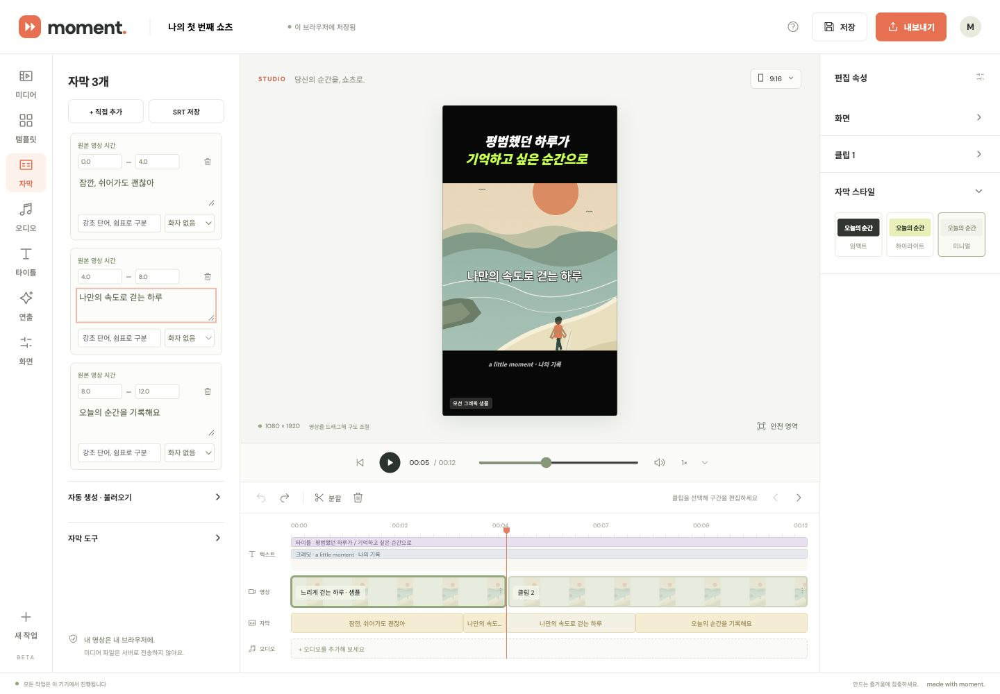

# Cycle 5: preserve timeline interactions while committing caption edits

Research and baseline checked on 2026-10-22 (UTC), before implementation.

## Evidence and comparison

[Clipchamp's caption workflow](https://support.microsoft.com/en-us/clipchamp/how-to-use-autocaptions-in-clipchamp) combines transcript correction, timestamp navigation and preview. Moment already exposes editable captions and timeline navigation, but the transition fails: type in caption 1, then click caption 3 in the timeline. Chrome commits the text but leaves the playhead at zero and does not focus caption 3. A second click is needed.

The caption change handler calls `edit` → `changed` → `renderTimeline` during focus transfer. This replaces every timeline button between pointer-down and click. The target button disappears before activation. New reverse-navigation controls would leave this existing workflow broken, so fixing this is the higher priority.

## Plan

1. Reuse caption timeline buttons by originating caption and clip occurrence, updating text, accessible name and geometry in place. Narration has one occurrence; source captions can repeat across clips. Preserve export's start/end/text contract.
2. Avoid replacing unchanged video/title track markup when caption edits refresh the timeline. Keep validation, undo snapshots, saving and drawing on the existing edit path. Do not seek on input or focus.
3. Add targeted DOM-identity regressions for text edits, retiming, repeats, reordered occurrences, removals and escaped text. Run all mapping/keyboard tests and real edit-then-click flows at desktop/narrow sizes, then push with the corrected repository identity and verify CI.

No new UI controls, helper labels, dependencies, file access or media processing are planned.

## Result and verification

Caption occurrence buttons now survive text and timing commits. Unchanged video and title tracks also keep their buttons. The shared caption projection adds a clip index for rendering identity; exported captions still contain only start/end/text. No navigation or keyboard shortcut semantics changed.

- Automated checks cover retained button identity, repeated clips, narration, retiming, removals/reordering, literal markup in text and unchanged track rendering. The complete syntax, UI/event harness and 21 Node tests pass; the editor-service example also passes.
- Chrome 156, built-in sample: editing text then clicking another caption, a video clip or a title works on the first click. Retiming a caption then clicking its timeline occurrence seeks to the updated start. Repeated edit/navigation, Enter/Space activation and undo/redo keep the expected text, playhead and focused caption row. No browser console errors were observed.
- Checked 1440×1000, 900×1000 and 390×844. Navigation resolves the correct row and time without horizontal overflow. At 390×844, the existing focus scroll leaves part of the focused textarea below the viewport (top 825, bottom 870 with an 844px viewport). This is a separate responsive focus-visibility issue to address next; this cycle does not claim to fix it.
- Browser checks used the task's dedicated local-editor tab and synthetic built-in sample. No private media, file upload, model download or rendering/export was exercised. The earlier restricted file-selection operation was not retried.

