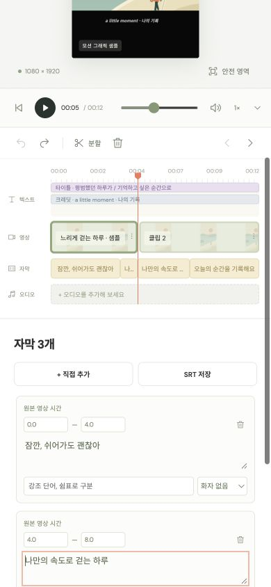

# Cycle 6: keep the focused caption visible

Research and baseline checked on 2026-10-23 (UTC), before implementation.

## Evidence and comparison

- [MDN: focus](https://developer.mozilla.org/en-US/docs/Web/API/HTMLElement/focus) documents native focus scrolling and `preventScroll` for controlling that separately.
- [MDN: scrollIntoView](https://developer.mozilla.org/en-US/docs/Web/API/Element/scrollIntoView) documents scrolling ancestor containers, including the viewport. Nearest alignment minimizes movement and leaves already-visible elements in place.
- [W3C: Focus Not Obscured](https://www.w3.org/WAI/WCAG22/Understanding/focus-not-obscured-minimum.html) explains why a visible focus target matters and recommends reducing partial obstruction. Partial visibility alone is not asserted to violate the minimum criterion here.

At 390×844 in Chrome 156, clicking the second occurrence of caption 2 correctly seeks to edited time 5 and focuses its textarea, but the field's bounds are y=825–870. Its bottom 26 pixels remain outside the viewport. The caption list and library panel are nested scroll containers; the document also scrolls at narrow sizes. The shared `focusCaption` currently calls only `focus()`. It is used by timeline navigation, adding/deleting captions and successful subtitle imports.

## Plan

1. Keep the existing shared focus target and separate focus from visibility: focus without automatic scrolling, then use native nearest-aligned scrolling through its ancestors. Do not add viewport-specific geometry, timers, listeners or controls.
2. Retain selection, text caret, exact timeline mapping, undo and import validation. Make the empty-list Add control visible through the same path.
3. Verify focus/scroll integration for navigation, add/delete/import in the existing harness. Use the built-in sample for real nested-container, keyboard, repeated navigation and resized viewport checks. Do not retry restricted browser file selection.

## Result and verification

The shared focus path now focuses without automatic scrolling and immediately scrolls the target into view with nearest alignment. A 4px CSS scroll margin preserves the existing focus outline at the viewport/container edge. There are no new controls, dependencies, resize listeners or changes to seeking and project state.

- Chrome 156 on macOS, dedicated task tab with the built-in sample: at 390×844, caption 2's field now spans y=795–840 instead of 825–870, with room for its outline. A six-caption list scrolls its inner container (500px) and document while keeping the newly added field visible. Deleting a caption focuses the surviving row; deleting the last focuses Add, and Space creates a new focused caption. Test edits were undone.
- Repeated timeline navigation, Enter/Space activation, Tab to the next field, text caret arrows and undo preserve the expected caption and time. Resizing and navigating at 320×568, 390×844, 900×1000 and 1440×1000 leaves the field fully visible with no horizontal overflow. At 320×568 its bottom is 564px. No browser console errors were observed.
- The existing UI/event harness now verifies the selected focus target and native scroll integration for repeated/trimmed caption navigation, add/delete and subtitle import. Syntax checks, the full harness, all 21 Node tests and the editor-service example pass. DOM mocks do not claim to verify layout; the browser checks above cover it.
- Actual subtitle file selection was not retried. Import success/failure UI paths are covered by synthetic in-memory fixtures. Real mobile hardware/virtual keyboards, other browser engines, media encoding and speech inference were not exercised.

Next observed issue: changing the zoom slider with ArrowRight moves 100% to 101% but leaves Undo disabled. The slider snapshots only on pointer-down; keyboard undo parity needs its own focused investigation.

