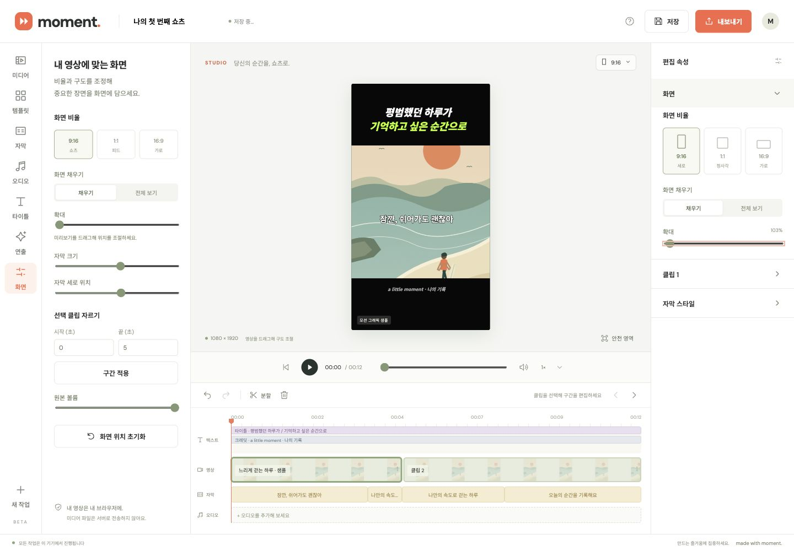

# Cycle 7: keyboard slider edits belong in undo history

Research and baseline checked on 2026-10-23 (UTC), before implementation.

## Evidence and comparison

- [W3C slider keyboard pattern](https://www.w3.org/WAI/ARIA/apg/patterns/slider/) describes Arrow, Home/End and optional Page keys. Existing native range inputs should retain those browser behaviors.
- [MDN native range input](https://developer.mozilla.org/en-US/docs/Web/HTML/Reference/Elements/input/range) documents range bounds and step values.
- [ProseMirror's history implementation](https://github.com/ProseMirror/prosemirror-history/blob/master/src/history.ts) groups adjacent changes into undo events and ignores transactions without steps. This supports grouping a continuous adjustment rather than recording every preview update; no editor library is needed here.

Chrome 156 reproduction: focus the inspector zoom slider and press ArrowRight twice. Zoom becomes 102%, but Undo remains disabled. Zoom, original/additional volume and narrow-screen zoom/volume/caption controls snapshot only on pointer-down. Design and effects sliders snapshot on focus, which creates history and clears redo even when no value changes, and does not distinguish successive pointer drags while focus remains.

## Plan

1. Share a small range-input history binder across the existing inspector, screen, audio, design and effects callers. Snapshot on the first actual value change, then retain live preview updates.
2. Group keyboard adjustments during the same focus session and each pointer gesture. End a group on blur, pointer boundaries, another edit or undo/redo. Do not intercept native keys, alter the seek slider, add timers or dependencies, or replace the existing project history.
3. Verify grouping, bounds/no-op, focus-only redo preservation, subsequent edits after undo/redo, interleaved controls, pointer cancellation and export guards. Check real keyboard/pointer and narrow-screen flows, then run the full suite and verify the normal push identity and CI.

## Result and verification

A shared 18-line binder now handles all project-setting range inputs. It snapshots on the first changed numeric value; later input events keep live preview updates. Pointer boundaries/blur, other edits, undo/redo and project reset end the group. Native keys, min/max/step, labels and the playback seek slider remain unchanged. Text and color controls retain their existing handlers.

- Full syntax checks, UI/event harness and 25 Node tests pass, including four new range-history tests. Integration checks cover all seven direct range bindings, design percentage conversion, scene and motion sliders, no-op redo preservation, interleaved edits and export guards. The editor-service example also passes without claiming rendered output.
- Chrome 156, built-in sample, dedicated task tab: Arrow repeats, Up/Down, Home/End and Page Up/Down retain native values. One Undo restores the starting zoom after a focused sequence; Redo restores its final value. Home at the minimum creates no history and retains Redo. Blurring and editing again creates a separate group.
- Two actual zoom drags produced 100% → 200% → 267%. Successive Undo actions restored 200%, then 100%, with no extra preview entries. Original volume, caption size, scene size and brightness changes were also exercised. Caption size 36 → 38 and brightness 1 → 1.1 each reverted with one Undo; focusing a design slider alone preserved Redo.
- At 390×844, zoom, caption size/position and volume mirror controls accept keyboard changes and undo. Caption size 36 → 38 → 36, position .55 → .53 → .55 and volume 1 → .98 → 1 were observed, with no horizontal overflow or unintended seek. Browser automation redacted the mirror zoom's numeric value; the direct inspector value and shared binding are separately verified. No console errors were observed. Test edits were undone.
- Additional-audio volume uses an in-memory fixture; no restricted file selection, private media, microphone access, model download or encoding was exercised. Real touch hardware and other browser engines remain untested.

Next code-backed priority: non-range text/color controls still snapshot on focus, potentially discarding Redo without a change. Investigate that independently with real native text/color commit behavior before broadening the range-only fix.

