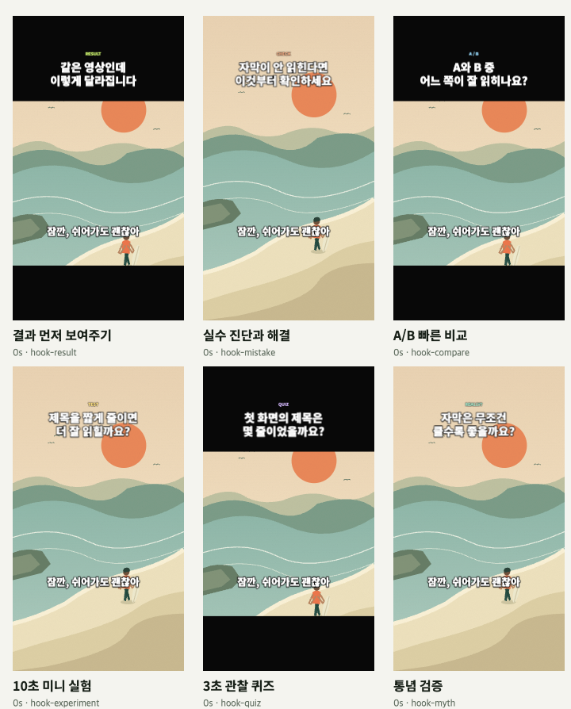
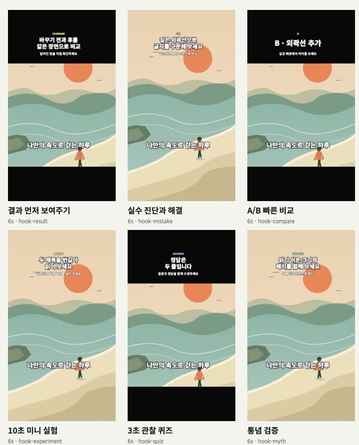

# Shorts 초반 훅 템플릿

첫 화면에서 내용을 알아보고, 초반에 약속한 답을 빠르게 확인하도록 만든 **초반 훅 템플릿 6개**입니다. 기존 10개와 합쳐 기본 템플릿은 **16개**입니다. 아래는 리서치 → 적용 사례 → 작업 계획 → 사용법과 검증 기준 순서입니다.

확인일: **2026-10-25**. 플랫폼의 공식 설명과 Moment의 편집 설계를 구분합니다. 템플릿이 조회수나 완주율 상승을 보장하지는 않습니다.



같은 기본 샘플 영상에 적용한 0초 화면입니다. 첫 문구는 등장 효과 없이 바로 보이며, 실제 결과·비교 장면은 편집자가 배치합니다.

## 1. 리서치: 첫 화면과 썸네일은 역할이 다릅니다

### 공식 자료로 확인한 내용

- **피드의 시작 화면:** YouTube Artists는 Shorts가 피드에서 바로 나타난다고 설명하며, 썸네일로 중요한 순간이나 결과가 명확한 장면을 권합니다. 무음·작은 음량 시청자를 위해 화면 텍스트도 권합니다. [Shorts for Artists, Shorts Tips](https://artists.youtube/intl/en-US/resources/shorts-for-artists/)
- **초반 훅:** YouTube 공식 블로그에 소개된 제작자 Jenny Hoyos는 첫 1초의 관심 유도와 놀라움 → 궁금증 → 만족의 구성을 강조합니다. 이는 제작자의 경험과 조언이며, YouTube가 정한 보편적인 1초·3초·10초 성공 기준은 아닙니다. 같은 글은 피드에서의 첫 시청 유도와 채널의 썸네일 브랜딩을 구분합니다. [Shorts deep dive, 2025-01-28](https://blog.youtube/creator-and-artist-stories/youtube-shorts-deep-dive/)
- **현재 썸네일 업로드:** 최신 도움말은 **인증 계정이 컴퓨터의 YouTube Studio에서 Shorts 커스텀 썸네일을 업로드**할 수 있다고 명시하며, 업로드 이미지의 권장 비율은 **9:16**입니다. 2026-07-24 발표는 YPP 제작자부터 제공한다고 설명했으므로 출시 당시 조건과 현재 도움말을 구분해야 합니다. [현재 도움말](https://support.google.com/youtube/answer/72431?hl=en), [출시 발표](https://blog.youtube/news-and-events/youtube-studio-custom-thumbnail-updates/)
- **추천과 성과:** YouTube는 시청을 선택한 비율, 평균 시청 시간, 평균 시청 비율, 좋아요와 시청 후 설문 등을 참고합니다. 특정 형식이 우대되는 것은 아니며 경쟁·관심사·계절성도 영향을 줍니다. [Search & discovery tips, Shorts](https://support.google.com/youtube/answer/11914225?co=YOUTUBE._YTVideoType%3Dshorts&hl=en)
- **조회와 계속 시청은 별개:** 조회는 재생 시작부터 집계되며, engaged view는 클릭해 시청하거나 초반을 지나 계속 시청한 경우입니다. 커버만 본 노출과 재생 시작도 구분됩니다. [Engaged views 설명, 2026-08-19](https://blog.youtube/inside-youtube/engaged-views-youtube-explained/)
- **게시 후 개선:** 유지율의 하락·재시청 구간을 살펴볼 수 있습니다. 자동으로 강조하는 '핵심 순간'은 **60초 이상 영상, 조회수 100 이상** 조건이 있으므로 12초 예제에 해당 기능이 표시된다고 가정하지 않습니다. [Audience retention 도움말](https://support.google.com/youtube/answer/9314415?hl=en)

### Moment의 설계 결정

**0초에 읽히는 문구와 영상, 3초 안의 구체적 질문·약속, 8초까지 첫 답**을 목표로 합니다. 사용자가 요청한 3~10초 관심 구간을 편집 가능한 기본 구성으로 만든 것이며, 플랫폼 규칙이나 검증된 성과 수치는 아닙니다.

재생 첫 화면은 영상 자체의 시작이고, 업로드용 커버는 탐색·채널 화면 등에서 내용을 알려 주는 별도 이미지입니다. Moment는 첫 화면의 문구와 시간별 카드를 제공하고, 기존 PNG 저장 기능으로 커버 후보를 만들 수 있게 합니다. YouTube 썸네일 등록이나 게시를 자동화하지는 않습니다.

## 2. 실제 제작에 적용할 6개 사례

아래는 사용자가 자기 영상에 적용할 수 있도록 직접 구성한 사용 시나리오입니다. 특정 채널의 실측 성공 사례나 플랫폼의 추천 형식이라는 뜻은 아닙니다. 예시의 결과·측정값·정답은 원본에서 실제로 확인한 내용으로 바꾸세요.

### 결과 먼저 보여주기 · `hook-result`

예: 완성된 커피를 먼저 보여 주고 같은 음료의 만드는 과정을 설명합니다.

- **0~2초:** 완성 컵과 결과를 요약하는 한 문장.
- **2~5초:** 어떤 과정을 볼 것인지 안내하고 핵심 동작을 보여 줍니다.
- **5~8초:** 따라 할 수 있는 방법·비율 등 첫 답을 제공합니다.
- **8초~끝:** 결과를 다시 확인하고 한 가지 요점을 남깁니다.

먼저 보여 줄 결과 장면은 사용자가 타임라인에서 골라 배치해야 합니다. 템플릿이 마지막 장면을 자동으로 앞으로 옮기지는 않습니다.

### 실수 진단과 해결 · `hook-mistake`

예: 흐릿한 제품 사진을 보여 주고 초점 설정 한 가지를 바로잡습니다.

- **0~2초:** 실제로 확인할 수 있는 문제와 짧은 진단 질문.
- **2~5초:** 문제를 일으킨 설정·행동을 짚습니다.
- **5~8초:** 수정 동작과 수정 후 장면을 보여 줍니다.
- **8초~끝:** 같은 실수를 줄일 점검 항목을 요약합니다.

원인이 여러 가지라면 해당 조건을 문구에 남기세요. 영상만으로 확인되지 않는 원인을 확정하지 않습니다.

### A/B 빠른 비교 · `hook-compare`

예: 동일한 장면의 보정 전·후를 차례로 보여 주고 선택 기준을 설명합니다.

- **0~2초:** A/B 질문과 비교할 기준 한 가지.
- **2~5초:** A의 실제 장면과 특징.
- **5~8초:** B의 실제 장면과 차이·판단.
- **8초~끝:** 어떤 조건에서 무엇을 고를지 요약합니다.

두 영상을 동시에 합성하는 분할화면 기능은 아닙니다. 비교 장면의 순서와 공정한 조건은 사용자가 준비합니다.

### 10초 미니 실험 · `hook-experiment`

예: 접는 방식에 따라 종이 다리의 지지력이 달라지는지 짧게 시험합니다.

- **0~2초:** 시험할 질문과 결과가 보일 대상.
- **2~5초:** 준비·조건과 핵심 시험 과정.
- **5~8초:** 실제 관찰한 결과를 공개합니다.
- **8초~끝:** 10초 안에 요약을 시작하고 적용 범위를 설명합니다.

'10초'는 초반 약속과 답의 편집 목표입니다. 기본 예제 전체 길이는 12초이며, 실제 실험을 10초에 수행했다는 인증이나 자동 측정 기능이 아닙니다.

### 3초 관찰 퀴즈 · `hook-quiz`

예: 책상 사진에서 달라진 물건 하나를 찾고, 해당 위치와 이유를 설명합니다.

- **0~3초:** 관찰 질문과 대상 화면.
- **3~5초:** 정답을 가리지 않는 짧은 힌트.
- **5~8초:** 정답을 명확하게 공개합니다.
- **8초~끝:** 왜 정답인지 설명합니다.

선택지·문구는 영상 그래픽입니다. 클릭형 퀴즈나 자동 정답 판별이 아닙니다. 정답 장면과 답 문구를 직접 맞추세요.

### 통념 검증 · `hook-myth`

예: 사진을 밝게 하면 세부도 항상 잘 보이는지 같은 장면으로 확인합니다.

- **0~2초:** 검증할 주장 한 가지를 질문으로 제시합니다.
- **2~5초:** 비교할 조건과 근거 장면을 보여 줍니다.
- **5~8초:** 근거가 뒷받침하는 답을 제공합니다.
- **8초~끝:** 결론과 예외·조건을 요약합니다.

템플릿은 사실검증을 수행하지 않습니다. 근거·출처와 결론의 범위를 확인하고 건강·금융 등 전문 주장에는 검증된 자료를 사용하세요.

## 3. 작업 계획과 구현 범위

1. **리서치와 사례 확정:** 피드의 첫 화면, 커버, 시청 지표를 구분하고 위 6개 시나리오로 편집 목적을 나눕니다.
2. **기존 카탈로그 확장:** 기존 10개를 유지하면서 위 ID 6개를 **초반 훅** 카테고리에 추가합니다. 검색·즐겨찾기·샘플 미리보기·기존 적용 버튼에서 선택합니다.
3. **첫 화면과 카드 구성:** 예시 적용 시 일반형은 0~2 / 2~5 / 5~8 / 8초~끝, 관찰 퀴즈는 0~3 / 3~5 / 5~8 / 8초~끝을 기준으로 구성합니다. 첫 문구가 등장 효과 때문에 첫 프레임에서 사라지지 않는지 확인합니다.
4. **기존 편집 계약 유지:** 스타일만 적용과 예시 내용 적용을 구분하고, 영상·대사 자막을 보존합니다. CLI/MCP도 같은 카탈로그와 `template.apply`를 사용합니다.
5. **검증 후 제공:** 카탈로그·적용·타이밍 검사를 실행하고 브라우저에서 실제 0초 화면과 카드 전환을 확인합니다. 자동 테스트와 시각 확인은 아래 기준을 사용하며, 게시 후 성과는 별도로 측정해야 합니다.

영상 재배열·자동 컷 선택·분할화면·통계 검증·YouTube 게시 기능은 추가하지 않습니다. 템플릿은 문구와 시각 구성을 제공하며, 영상 내용에 맞추는 작업은 편집자가 맡습니다.

## 4. 사용법

1. 영상을 불러오고 **화면**에서 9:16을 선택합니다. 약속한 결과나 관찰 대상이 첫 장면에 보이도록 클립 순서·트림을 편집합니다.
2. **템플릿 → 초반 훅**에서 목적에 맞는 템플릿을 미리 봅니다. **현재 장면** 비교로 원본 위에 문구가 잘 보이는지도 확인합니다.
3. 기존 문구를 보존하려면 **스타일만 적용**을 선택합니다. 위 시간별 문구 구성을 출발점으로 쓰려면 **예시 구성까지 적용**을 선택하고 제목·크레딧·카드 내용을 자기 영상에 맞게 고칩니다. 후자는 해당 문구를 교체하므로 작성한 내용이 있다면 먼저 프로젝트를 저장하세요. 두 방식 모두 영상과 대사 자막은 유지합니다.
4. 무음으로 처음 10초를 보고 질문·근거·답이 연결되는지 확인합니다. 제목·카드·자막이 서로 겹치면 위치나 시간을 조절합니다.
5. 커버 후보가 보이는 시점에서 **화면 → 미리보기 PNG 저장**을 선택합니다. 이는 **클릭할 때 표시된 캔버스**를 저장합니다. 세로 540×960, 정사각형 960×960, 가로 960×540이며, 1080p 재렌더링·자동 탐색·YouTube 등록을 하지 않습니다. YouTube에 사용할 이미지는 해당 계정의 Studio에서 직접 설정합니다.
6. 지원되는 형식으로 영상을 내보내고 다운로드한 파일의 시작과 답 공개 장면을 재생해 확인합니다.

### 시간 규칙

기본 예제는 **12초**입니다. **예시 구성을 적용할 때 출력 길이가 12초 이상이면 앞의 초 단위 경계를 그대로 유지**하고 마지막 요약만 끝까지 이어집니다. 따라서 60초 영상에 적용해도 적용 직후의 첫 답 구간은 5~8초입니다.

**적용 시 출력 길이가 12초 미만일 때만** 전체 구성을 `출력 길이 / 12` 비율로 압축합니다. 예를 들어 6초 출력에서는 일반형 경계가 0 / 1 / 2.5 / 4 / 6초, 퀴즈는 0 / 1.5 / 2.5 / 4 / 6초가 됩니다. 짧은 영상은 문구를 줄이거나 표시 시간을 직접 조정하세요. '3초 관찰'과 '10초 실험'이라는 이름의 숫자도 압축된 영상의 실제 대기·측정 시간 보장은 아닙니다.

**적용 후 클립 길이·배속을 변경하면 기존 편집 규칙에 따라 카드 시간도 비례 변경됩니다.** 위 경계가 영구히 고정되는 것은 아니므로 초반 구간을 다시 확인하고 필요하면 카드 시간을 직접 조정하세요. 예시 구성을 다시 적용하면 작성한 문구가 교체되므로, 시간을 맞추기 위해 무심코 재적용하지 마세요.

### CLI로 적용하기

기존 프로젝트 JSON에 아래처럼 적용합니다. `--out`에는 새 출력 경로를 지정하며 원본 미디어는 별도로 보관합니다.

```sh
node cli/moment.mjs exec template.apply --project project.json --json '{"templateId":"hook-result","withContent":true}' --out hook-project.json
```

`withContent`를 생략하거나 `false`로 지정하면 작성한 문구를 보존하는 스타일 적용입니다. 다른 예제를 쓰려면 위 6개 ID 중 하나로 바꾸세요. CLI/MCP는 프로젝트 설정을 편집하며 영상을 인코딩하거나 썸네일을 등록하지 않습니다.

## 5. 검증 기준

- **목록과 적용:** 기존 ID 10개와 새 ID 6개가 고유하며, 검색·카테고리·즐겨찾기·미리보기·CLI/MCP에서 접근할 수 있어야 합니다. 예시 적용 후 프로젝트 검증을 통과하고, 스타일 적용은 작성한 제목·크레딧·카드·대사 자막의 내용을 보존해야 합니다.
- **첫 프레임:** 0초에서 핵심 문구와 영상이 보여야 합니다. 1초·3초에 무음으로 주제를 이해할 수 있어야 하며, 카드 전환 시 겹침·잘림을 확인합니다.
- **답의 연결:** 기본 12초 예제에서 6초에는 근거나 답이 진행되고, 8초·10초에는 약속한 결과나 이유를 확인할 수 있어야 합니다. 퀴즈는 5초부터 정답 구간입니다. 문구가 실제 영상보다 앞서 결과를 확정하지 않도록 편집합니다.
- **짧고 긴 출력:** 6초·12초·60초 및 배속이 적용된 출력 길이에서 예시 구성을 적용해 확인합니다. 적용 직후 12초 이상에서는 초반 경계가 늘어나지 않고, 12초 미만에서는 끝을 넘는 카드가 없어야 합니다. 적용 후 클립 길이·배속을 바꾸면 카드 시간도 기존 규칙에 따라 비례 변경되는지 확인하고, 초반 약속·답의 시점을 다시 검토합니다.
- **결과물:** PNG가 현재 캔버스 크기와 클릭 시점의 문구를 담는지 확인하고, 실제 내보낸 영상에서 첫 화면·카드·자막이 보이는지 재생합니다.
- **게시 후 성과:** 같은 주제·비슷한 길이의 영상끼리 시청 선택/이탈, engaged views, 평균 시청 시간·비율과 유지율을 비교합니다. 원본 조회수 하나로 훅의 효과나 인과관계를 확정하지 않습니다. 작은 표본이나 템플릿 변경만으로 완주·추천 증가를 보장하지 않습니다.

### 구현 검증 결과 · 2026-10-25

최신 원격 변경과 통합한 뒤 `npm test`의 **671개 테스트가 통과**했습니다. 새 템플릿의 첫 프레임 불투명도, 짧고 긴 출력·배속·재배열된 클립의 적용 시간, 기존 콘텐츠 보존, 프로젝트 저장·복원, 다국어 검색과 미리보기 시작 시점을 확인했습니다.

실제 브라우저에서 훅 필터와 예시 적용을 확인하고 공유 Canvas 렌더러로 6종 각각의 **0·1·3·6·10초** 화면을 검사했습니다. 관찰 퀴즈의 0초 화면을 기존 PNG 저장 버튼으로 내려받아 **540×960** 이미지와 문구도 확인했습니다. 아래는 기본 샘플 영상의 6초 화면입니다. 실제 YouTube 게시 후 시청 성과는 측정하지 않았습니다.


